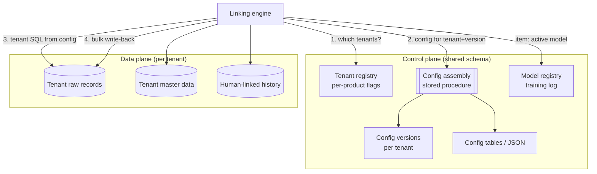
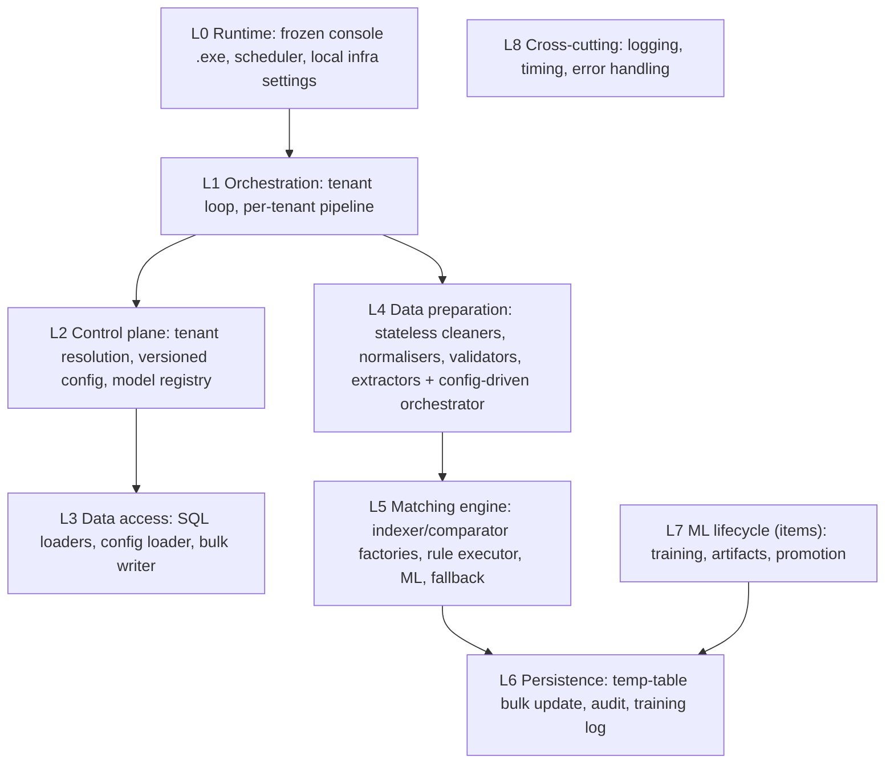
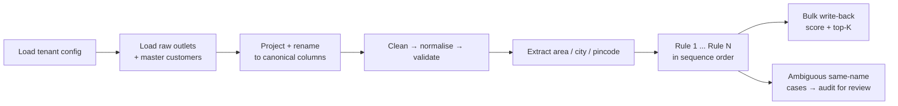
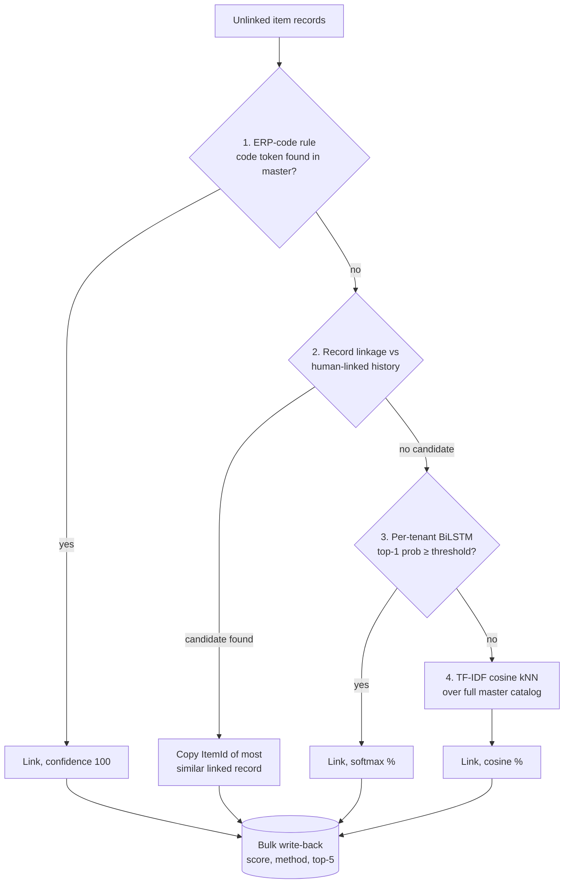
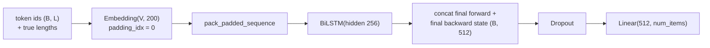
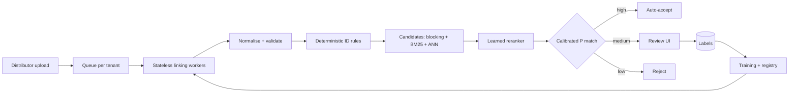

# Multi-Tenant Entity Linking Platform (Customer & Item Linking AI)

A configuration-driven, multi-tenant platform that automatically links noisy distributor records to brand master data. It has two engines on one layered architecture:

- **CustomerLink AI** links retail outlets using validated government identifiers, extracted location fields and an ordered set of probabilistic record-linkage rules.
- **ItemLink AI** links products through a four-stage cascade: an ERP-code rule, record linkage against human-linked history, a per-tenant PyTorch BiLSTM classifier, and a TF-IDF nearest-neighbour fallback.

> **Note.** I designed and built this system as part of my work at a distributor-analytics company. The source code is proprietary and is not included. This repository documents the architecture, design decisions and engineering techniques. Client names, data, infrastructure details and exact per-client results are omitted or anonymised.

---

## Table of contents

1. [Highlights](#highlights)
2. [The problem](#the-problem)
3. [Platform architecture](#platform-architecture)
4. [CustomerLink AI](#customerlink-ai)
5. [ItemLink AI](#itemlink-ai)
6. [Engineering techniques worth noting](#engineering-techniques-worth-noting)
7. [Results](#results)
8. [Evolution: v1 to v2](#evolution-v1-to-v2)
9. [Lessons learned and roadmap](#lessons-learned-and-roadmap)
10. [Tech stack](#tech-stack)
11. [Glossary](#glossary)

---

## Highlights

- **Multi-tenant by configuration.** One codebase and one binary serve 30+ brands. Each tenant has versioned config, its own rules and, for items, its own model. Onboarding a tenant needs no code change.
- **Item linking reached about 91.7% accuracy over roughly 4.6 million records across 32 tenants**, with a median per-tenant accuracy of 100%.
- **Explainable matching.** Every link carries a confidence score, the method or rule that produced it, and top-5 alternative suggestions for human review.
- **Set-based bulk write-back.** Replacing per-row updates with a temp table, ODBC parameter arrays and one `UPDATE ... FROM ... JOIN` cut database round-trips by orders of magnitude.
- **Parallel per-tenant GPU training** with a model registry, experiment tracking and best-checkpoint selection.
- **Relational configuration store** assembled into JSON by a stored procedure, plus a procedure that deep-clones a whole tenant configuration in one call.

---

## The problem

Brands sell through thousands of distributors. Distributors upload sales, stock and customer data from their own systems, and each one names customers and products differently:

| Same real-world entity | Distributor spellings |
|---|---|
| A product | `Pneumatic Cylinder PCX-32-150-A`, `pneu cyl pcx32x150`, `PCX 32 X 150 A` |
| A retail outlet | `Sharma Medical Stores, MG Rd`, `SHARMA MEDICALS`, `Sharma Med. Store (Andheri E)` |

Before any brand-level analytics can run, every distributor record must be **linked** to one record in the brand's master data. This was a manual process across millions of rows per brand. Brands span liquor, pharma, medical devices, industrial goods and FMCG, and each has different schemas, identifiers and data quality.

**Goals**

1. Auto-link as many records as possible with high precision.
2. Attach a confidence score and top-K suggestions so reviewers only check uncertain links.
3. Support every brand from one codebase, configured per tenant.
4. Learn from historical human links, and still handle new master records with no history (cold start).
5. Run on the existing on-premises Windows Server + SQL Server estate as standalone executables.

---

## Platform architecture

### Multi-tenancy model

A **tenant** is a brand. The platform uses a hybrid pattern: a **shared control schema** with **tenant-specific data tables**, where each tenant's config supplies the SQL that routes to its own data.

| Concern | Approach |
|---|---|
| Tenant registry | One registry table with an active flag and per-product processing flags (customer linking, item linking, model training) |
| Configuration | Versioned per tenant. A stored procedure returns one JSON document `{config, rules}` for a tenant and version |
| Data routing | The queries for raw, master and history data, and the update and audit statements, come from the tenant's config |
| Schema differences | Config projects each tenant's columns and renames them to canonical names, so engine code sees one schema |
| Models (items) | One model per tenant, tracked in a registry table keyed by tenant, with artifacts in a per-tenant folder |
| Onboarding | Insert the tenant, a config version and its config. For customers, one procedure clones a full config from a similar tenant |
| Safe changes | Create a new config version, test it, then switch the active flag. Old versions remain for rollback |



### Layered architecture

Both engines follow the same layering. Dependencies point downward only.



**Design rules**

- **Stateless helpers, config-driven orchestrators.** Cleaning functions are pure static methods. An orchestrator decides which to apply from config and resolves validators and normalisers **by name**, so a config row can switch on a validator without code changes.
- **Factories translate config into library objects.** Indexer and comparator factories turn JSON into record-linkage `Index` and `Compare` objects. This is the boundary between declarative config and imperative code.
- **Uniform output contract.** Every matcher emits `rawId, TargetId, Confidence, TopSuggestions, Method`. The persistence layer only knows that shape, so matchers are pluggable.
- **Infrastructure config is local; business config is central.** Local settings hold only connection details. Everything business-related lives in the database per tenant.

---

## CustomerLink AI

### Pipeline



### Data preparation

| Step | Technique | Why it matters |
|---|---|---|
| Base cleaning | Insert spaces at letter/digit boundaries using zero-width lookarounds, strip punctuation, collapse spaces, lowercase | `"Shop No.12,MG Rd"` → `"shop no 12 mg rd"`; consistent tokens for every comparator |
| Normalisers | Tax IDs: remove spaces and uppercase. Postal code: digits only | Restores canonical identifiers after base cleaning splits them |
| Validators | Regex checks for GSTIN (`^[0-9]{2}[A-Z]{5}[0-9]{4}[A-Z][1-9A-Z]Z[0-9A-Z]$`), PAN, 6-digit PIN without placeholders, licence numbers without junk tokens such as `NA` or `0` | **Critical:** placeholder values would otherwise fall into one giant block and exact-match each other, creating confident false links. Invalid values are set to null and drop out of rules |
| Master extraction | Split a composite `"area - city"` field by position, negative positions allowed | Gives structured area and city on the master side |
| Raw extraction (vocabulary) | Build area and city vocabularies from the master, sort **longest first**, find the first one contained in the space-free address | Longest-first avoids `"mumbai"` winning over `"navi mumbai"`; space-free matching tolerates `NaviMumbai`, `Navi-Mumbai` |
| Raw extraction (regex) | Pincode `\b[1-9][0-9]{5}\b` from the address | Recovers a strong location signal from free text |
| Second cleaning pass | Clean and validate the newly extracted columns | Extracted values get the same quality controls |

### Matching rules

Rules run in sequence. Each rule only sees records not matched by earlier rules. A typical production rule set:

| Seq | Rule | Candidate generation | Weighted comparisons | Max score |
|---|---|---|---|---|
| 1 | Tax-ID rule | Sorted neighbourhood on GSTIN (window 9) | GSTIN exact 0.60, pincode exact 0.10, name Jaro-Winkler 0.20, address cosine 0.10 | 100 |
| 2 | Address rule | Sorted neighbourhood on name **∪** on area | Name JW 0.50, address cosine 0.20, area JW 0.15, pincode exact 0.15 | 100 |
| 3 | Name rule | Sorted neighbourhood on name | Name JW 0.10 | 10 |

Liquor tenants use a licence-number rule first, and some use a pincode rule. These are all config variations, not code changes.

**Design reasoning**

- **Order by identifier strength.** Near-unique identifiers go first with high weights. Name alone is the weakest evidence.
- **Name-only matches are deliberately capped at a score of 10.** They still give reviewers a suggestion, but never look trustworthy.
- **Sorted neighbourhood instead of blocking for tax IDs.** A block needs an exact key, so one typo loses the pair. Sorted neighbourhood pairs records that are close in sorted key order, which catches many typos.
- **Union of indexers.** The address rule takes candidates similar by name **or** by area. That gives recall from either signal, and the weighted score sorts it out.

**Scoring:** `score = 100 × Σ weightᵢ × featureᵢ`, a hand-tuned simplification of the Fellegi-Sunter model, with features in 0–1 from exact, Jaro-Winkler and cosine comparators.

### Scaling candidate pairs: chunked comparison

Large blocks can produce tens of millions of candidate pairs. Pairs are compared in chunks of 100,000. For each chunk: compute features, score, keep the top-N per raw record. After all chunks: take a global top-N. This is correct because top-N is **decomposable**: any global top-N candidate is in its own chunk's top-N.

### Same-name collision detection

Many outlets share names, such as the same pharmacy name in several areas of one city. When several master candidates exceed a name-similarity threshold for one raw record, the engine requires agreement on location fields (area and city similarity ≥ 0.90). If no candidate qualifies, it does **not** auto-link. Instead it writes all candidates to an **audit table** with the rule name, rule sequence, config version, run id and every feature score, and flags them for human review.

### Configuration as relational data

Customer configuration is stored in normalised tables rather than as a JSON blob: column groups, rename mappings, SQL queries, cleaning columns, validators, normalisers, index columns, extraction settings, targets, vocabulary sources, regex extractors, and a rule set with rules, required columns, indexing, comparisons and collision settings. All child tables carry foreign keys.

- **Assembly procedure:** builds one JSON document from these tables with `FOR JSON PATH`, `JSON_QUERY` and `STRING_AGG`.
- **Clone procedure:** deep-copies a tenant's entire config graph to a new tenant and version (see [techniques](#engineering-techniques-worth-noting)).

| Relational config (customers) | JSON blob config (items) |
|---|---|
| Referential integrity, typed weights, queryable ("which tenants weight tax ID above 0.5?") | Flexible; nested ML hyperparameters fit naturally |
| Set-based cloning and versioning | No schema change needed for new keys |
| More complex assembly procedure | No built-in validation |

---

## ItemLink AI

### Four-stage cascade



Cheap, near-certain methods run first and remove records. Fuzzier, costlier methods only see what is left. Every stage returns `(matches, remaining)`.

| Stage | Technique | Strength |
|---|---|---|
| 1. ERP-code rule | Build a set of master product codes; scan cleaned name tokens for a hit (O(1) per token); hash join | Deterministic, near-certain |
| 2. Record linkage | Block on distributor **∪** block on product code; compare distributor (exact), code (exact), name (Jaro-Winkler); weighted score; top-K. **Compares against human-linked history, not the master** | Instance-based learning: reuses past human decisions in each distributor's own phrasing |
| 3. BiLSTM classifier | Per-tenant supervised model over master item ids, trained on historical links | Learns fuzzy, abbreviated naming |
| 4. TF-IDF fallback | Word TF-IDF over master names, cosine kNN | **Open-set:** covers new master items the classifier has never seen (cold start) |

**TF-IDF detail:** the token pattern `\b\w+\b` deliberately **keeps single-character tokens**. scikit-learn's default `\b\w\w+\b` drops them, but after letter/digit splitting, tokens such as `m 8`, `a` and `2` carry meaning in product names. A character 1–4-gram mode is available for typo-heavy tenants.

### Model



- **Packed sequences** skip padded steps, so the final hidden state comes from each sequence's real last token, not from padding.
- **Bidirectional,** because brand, model, size and pack appear in any order in product names.
- The **tokenizer vocabulary and label encoder are saved inside the checkpoint**, so serving always uses the same mappings as training. That avoids training-serving skew.

### Training pipeline

1. Load human-linked history and master data for the tenant; clean with the same code as inference.
2. **Deduplicate** on (distributor name, master name) to remove volume bias and identical rows on both sides of the split.
3. Keep classes with **at least 5 samples**, so a stratified split can place every class in test. Rarer items are handled by record linkage and TF-IDF.
4. **Stratified 80/20 split.** The tokenizer and label encoder are fitted on the training split only.
5. **Balanced class weights** in cross-entropy, `w_c = N / (C · N_c)`, so rare items are not ignored.
6. **Adam** optimiser with **mixed precision (AMP)** on GPU: `autocast` for float16 compute and `GradScaler` to prevent gradient underflow.
7. After each epoch, evaluate and keep a copy of the **best** weights; reload them at the end.
8. Report accuracy and **macro** precision, recall and F1. Macro averaging treats every item equally and exposes rare-class weakness.
9. Save the checkpoint, rebuild the TF-IDF index from the current master, and log the run (metrics, per-epoch loss, config snapshot, artifact path) to a **registry table**. Inference loads the active model for the tenant from that registry.

**Parallel training:** one process per GPU via `ProcessPoolExecutor`. Tenants are assigned round-robin, each process has its own database connection, and failures are isolated per tenant. `multiprocessing.freeze_support()` makes this work inside a frozen Windows executable, where child processes are spawned.

**Why PyTorch rather than TensorFlow:** the production compute is a Windows Server VM. TensorFlow caused repeated complications there: native Windows GPU support ended after 2.10, and installation and packaging were fragile. PyTorch ran seamlessly, with native Windows CUDA builds and simple bundling into the executable.

**Why a BiLSTM rather than a transformer:** small per-tenant datasets, short code-like text, CPU-friendly deployment as a frozen executable, and no access to a model hub. It trains in minutes per tenant.

---

## Engineering techniques worth noting

**Set-based bulk write-back**

```sql
CREATE TABLE #temp_updates (raw_id INT, target_id INT, score FLOAT,
                            is_matched INT, top_n NVARCHAR(MAX), matched_at DATETIME, method VARCHAR(50));
-- cursor.fast_executemany = True; executemany(INSERT INTO #temp_updates VALUES (?,?,?,?,?,?,?), rows)
UPDATE t SET t.TargetId = u.target_id, t.Confidence = u.score,
             t.TopSuggestions = u.top_n, t.ProcessedDate = u.matched_at
FROM tenant_raw_table t JOIN #temp_updates u ON t.Id = u.raw_id;
DROP TABLE #temp_updates;  -- one transaction; rollback on error
```

- `fast_executemany` sends parameters as ODBC arrays instead of one round-trip per row.
- One join update lets SQL Server optimise the whole change set.
- It runs on a single raw DBAPI connection, because `#temp` tables are **session-scoped** and a pooled connection could switch sessions.

**Returning large JSON from a stored procedure in one value.** A top-level `SELECT ... FOR JSON PATH` streams output as several rows of about 2,033 characters, which truncates the document for a client that reads one row. Wrapping it in a scalar subquery, `SELECT (SELECT ... FOR JSON PATH, WITHOUT_ARRAY_WRAPPER) AS Json`, returns a single `nvarchar(max)`.

**Cloning a config graph with `MERGE ... ON 1=0 ... OUTPUT`.** `INSERT ... SELECT ... OUTPUT` can only output inserted columns, not source columns. `MERGE` can output both, so `ON 1=0` forces an insert for every row while `OUTPUT src.OldId, inserted.NewId INTO #map` builds the old-to-new id mapping needed to copy child rows.

```sql
MERGE ConfigColumnGroups AS tgt
USING (SELECT ColumnGroupId, GroupType FROM ConfigColumnGroups WHERE ConfigId = @SourceConfigId) src
ON 1 = 0
WHEN NOT MATCHED THEN INSERT (ConfigId, GroupType) VALUES (@TargetConfigId, src.GroupType)
OUTPUT src.ColumnGroupId, inserted.ColumnGroupId INTO #ColumnGroupMap;
```

**`SET NOCOUNT ON` before every read.** Without it, SQL Server sends row-count messages that pyodbc exposes as results without rows, and `pandas.read_sql` fails.

**`ConfigParser(interpolation=None)`.** A `%` in a password or SQL string is otherwise parsed as interpolation syntax and crashes at startup.

**Packaging with cx_Freeze.** Hidden imports are listed explicitly (SQLAlchemy's MSSQL dialect, NumPy and SciPy internals, Torch submodules), the Torch DLL folder is bundled, and the recursion limit is raised before importing cx_Freeze to cope with Torch's deep import graph.

---

## Results

Evaluated by comparing the AI's link with the link a human finally confirmed. Accuracy is correct records divided by all records.

| Metric | Item linking | Customer linking |
|---|---|---|
| Tenants evaluated | 32 | 30 |
| Records evaluated | ~4.6 million | ~2.2 million |
| Overall accuracy | **~91.7%** | ~50.7% |
| Median per-tenant accuracy | **100%** | 66% |
| Tenants at a high bar | 28 of 32 at ≥97% | 9 of 30 at ≥80% |

**Reading the numbers**

- Item linking's weighted figure is pulled down mainly by industrial tenants with huge catalogues of near-identical part numbers that differ only by short suffixes. Most tenants are at or near 100%.
- Customer linking is a **rules-only baseline** on much harder data: generic outlet names, free-text addresses, missing or placeholder identifiers, and many legitimately similar outlets in one city. Tenants whose customers carry tax IDs score high. Some low scores reflect records that were never reviewed, which count as not correct.
- Every record receives a suggestion, so these are accuracies at full coverage. Calibrated thresholds with abstention would raise precision on the auto-applied subset.

---

## Evolution: v1 to v2

| | v1 (2024) | v2 (2026 re-architecture) |
|---|---|---|
| Tenancy | One deployment per client, settings file per client | One multi-tenant service with versioned per-tenant config in the database |
| Customer matching | Character n-gram TF-IDF over one concatenated string of name + licence + address, argmax cosine with a global threshold | Separate cleaned and validated fields, extracted location, ordered explainable rules with blocking and per-field comparators |
| Item matching | TF-IDF with a threshold; later a TensorFlow model | Four-stage cascade with a per-tenant PyTorch BiLSTM |
| Write-back | String-built `UPDATE` per row, commit per row | Temp table + `fast_executemany` + one set-based update |
| Explainability | A single similarity number | Method or rule name, top-K, audit trail with feature scores |
| ML lifecycle | Manual | Parallel GPU training, run registry, active-model resolution |

v1 did not scale: concatenated fields let long addresses dominate short identifiers, dense similarity matrices cost O(batch × master) memory, one global threshold could not fit 30 tenants, and per-row SQL was slow.

---

## Lessons learned and roadmap

**Lessons**

- Validating identifiers mattered as much as the matching algorithm. Junk values silently create confident false matches.
- Keep preprocessing identical between training and serving. An empty-string edge case once produced zero-length sequences that crashed sequence packing; the fix was to map empty input to an unknown-word token everywhere.
- Confidence scores from different methods (rule score, softmax probability, cosine) are not on the same scale. One review threshold cannot serve them all.
- Choose the framework that runs reliably on the hardware you actually have.

**Roadmap**

1. **Retrieve-then-rerank:** a contrastively trained bi-encoder plus approximate nearest-neighbour search for candidates, then a learned reranker. Solves cold start and output-layer growth for items.
2. **Learned pair scoring for customers:** logistic regression or gradient-boosted trees on comparator features (plus geo distance), trained on reviewed links, replacing hand-tuned weights.
3. **Calibration and abstention:** map every method to P(correct) and route to auto-accept, review or reject with per-tenant thresholds chosen from precision-coverage curves.
4. **Champion/challenger promotion** on a frozen time-based test set, with versioned artifacts per training run.
5. **Shared core library** for cleaning, factories, rule execution and persistence used by both engines.
6. **Active learning:** review the most valuable uncertain records first and feed corrections back into training.
7. **Tenant fairness:** queue partitions and quotas so very large tenants do not delay others.
8. **Config validation** with JSON Schema or Pydantic, and Git-backed config publishing.



---

## Tech stack

| Area | Tools |
|---|---|
| Language and data | Python, pandas, NumPy |
| Database | Microsoft SQL Server, T-SQL (`FOR JSON`, `MERGE ... OUTPUT`, temp tables), SQLAlchemy, pyodbc |
| Record linkage | `recordlinkage` (blocking, sorted neighbourhood, exact / Jaro-Winkler / cosine comparators) |
| Machine learning | PyTorch (Embedding, BiLSTM, packed sequences, AMP), scikit-learn (TF-IDF, NearestNeighbors, LabelEncoder, class weights, metrics) |
| Parallelism | `concurrent.futures.ProcessPoolExecutor`, multiprocessing |
| Packaging and ops | cx_Freeze Windows executables, scheduled batch runs, file logging |

---

## Glossary

- **Record linkage / entity resolution:** finding records that refer to the same real-world entity without a shared key.
- **Blocking:** only comparing record pairs that share a key value. **Sorted neighbourhood:** sorting by a key and comparing records within a sliding window.
- **Jaro-Winkler:** string similarity that rewards matching characters in order and a common prefix. `JW = J + ℓ·0.1·(1 − J)`, where `ℓ` is the common prefix length (up to 4).
- **Fellegi-Sunter model:** per-field agreement weights `log₂(m/u)`, where m and u are the probabilities of agreement for true matches and non-matches.
- **TF-IDF:** term weight `tf × idf`, with `idf = ln((1 + N)/(1 + df)) + 1`; rare, discriminative tokens get high weight.
- **Cosine similarity:** `a·b / (‖a‖‖b‖)`, the angle between two vectors.
- **Macro F1:** the F1 score averaged equally over classes, so rare classes count as much as common ones.
- **AMP (automatic mixed precision):** float16 compute with float32 master weights and dynamic loss scaling.
- **Training-serving skew:** a mismatch between preprocessing at training time and at serving time.
- **Open-set vs closed-set:** a classifier can only output classes it was trained on; retrieval can return any indexed item.
